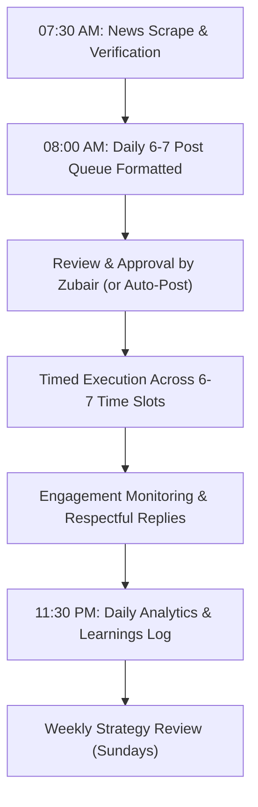

# 30-Day X (Twitter) Growth & Content Master Plan
**Account Lead:** Social Media Manager for @zubair.ahmad4545438@gmail.com
**Target:** Organic growth to maximize reach and followers in 30 days
**Market Focus:** Pakistan (National & Regional) + High-Relevance Global Stories
**Core Rule:** Report, Don't Opine. 100% Verified Facts. 0% Sensationalism or Rumors.

---

## 1. Content Pillars & Daily Distribution (6-7 Posts/Day)

| # | Time Slot (PKT) | Content Pillar | Format | Target Audience Hook |
|---|----------------|----------------|--------|----------------------|
| **1** | **08:30 AM** | National News / Politics / State Affairs | Single Post / Key Facts | Morning briefing before work/commute |
| **2** | **11:30 AM** | Economy / Industry / Trade & Finance | Short Explainer | Business community, professionals |
| **3** | **02:00 PM** | Science / Tech / Innovation & Startups | Single Post | Tech enthusiasts, youth, students |
| **4** | **05:30 PM** | Sports (Cricket / National Athletes) | Single Post + Engagement Question | Post-work relaxation & fan discussion |
| **5** | **08:15 PM** | Major Breaking National / Regional Story | Short Thread (2-3 posts) | Evening prime news consumption |
| **6** | **09:45 PM** | Viral Global Story (Middle East / World Affairs) | Single Post / Context Brief | International context for Pakistani audience |
| **7** | **11:15 PM** | Feature / Inspiring Event / Late-Night Perspective | Reflective Single Post | Late-night casual scrollers |

---

## 2. Editorial Rules (Strict Guardrails)

1. **Neutrality & Factuality:**
   - Report facts without partisan commentary, bias, or emotional adjectives.
   - Never take political sides or attack individuals, political parties, or religious groups.
2. **State & Institutional Respect:**
   - Strictly respect the Pakistan Army, Judiciary, and all constitutional institutions. Report only verified official updates or court proceedings with zero derogatory commentary.
3. **Mandatory Source Verification:**
   - Every post must cite at least one recognized tier-1 outlet (Dawn, Geo, Express Tribune, Reuters, AP, BBC, Al Jazeera, or official press releases).
   - Direct link to the source must always be included.
4. **Writing Style:**
   - Human, natural, conversational, active voice.
   - 1 to 2 hashtags maximum (e.g. `#PakistanNews`, `#Cricket`).
   - Clear opening line (hook) without deceptive clickbait.
5. **Growth Ethics:**
   - 100% organic: no follow-for-follow loops, no engagement pods, no purchased followers.
   - Genuine value that invites retweets and bookmarks.

---

## 3. Daily Execution Workflow

---

## 4. Performance Tracking Metrics

Track every evening in `daily_logs/YYYY-MM-DD.md`:
- **Impressions & Views**
- **Likes & Bookmarks**
- **Reposts (Retweets)**
- **Replies & Discussion Quality**
- **Profile Visits**
- **New Followers Gained**
- **Key Takeaways & Tweaks for Next Day**
